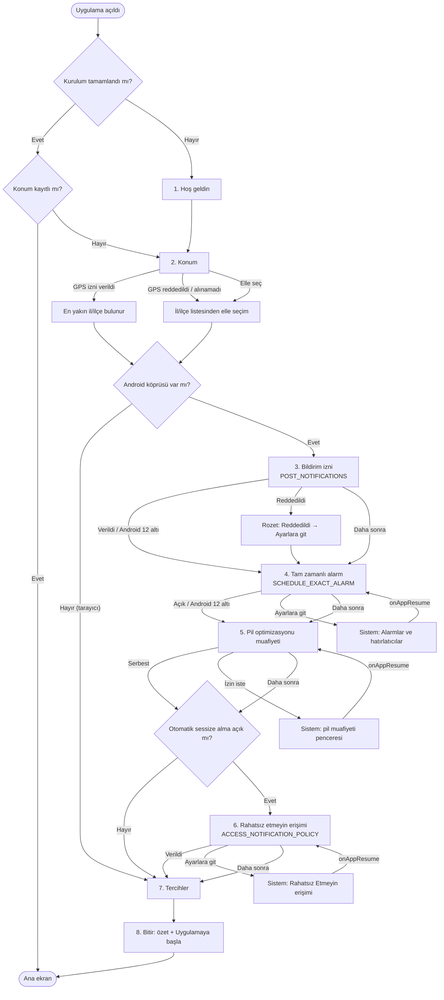

# Tam Vakti — İlk Açılış Kurulum Şeması

Bu belge, uygulamanın ilk açılışta göstereceği **kurulum sihirbazının hedef akışını** tanımlar.
Bir sonraki adımda (`TODO.md` → "Kurulum sihirbazını uygula") sihirbaz bu şemaya göre yeniden yazılacak.
Belgenin sonunda mevcut sihirbazla farklar listelenmiştir.

İncelenen kaynaklar:

- `www/index.html` → `#onboardingModal` (5 adım: Hoş geldin, Konum, Bildirim, Widget/Canlı takip, Vakit ayarları)
- `www/js/app.js` → `openOnboarding`, `closeOnboarding`, `goToOnboardingStep`, `onboardingLocateWithGPS`,
  `onboardingEnableNotifications`, `completeOnboarding`, `getPermissionState`, `fixPermission`, `refreshPermissionStatus`
- `android/app/src/main/AndroidManifest.xml` ve `MainActivity.kt` JS köprüsü (`AndroidBridge`)

## Genel kurallar

- Sihirbaz **yalnızca ilk açılışta** çıkar (`localStorage.tamvakti_onboarding_completed !== "true"`).
  Konum hiç seçilmemişse de açılır, ama doğrudan **Konum** adımından başlar.
- Sihirbaza yeni adım eklenince `TamVaktiApp.ONBOARDING_VERSION` artırılır; eski sürümden güncelleyen kullanıcıya sihirbaz bir kez daha açılır (`tamvakti_onboarding_version`).
- Ayarlar'da **"Kurulumu yeniden başlat"** satırı sihirbazı 1. adımdan tekrar açar (tercihler silinmez).
- Her izin adımı aynı kalıbı izler:
  1. Neden gerektiğini anlatan kısa metin ve önizleme.
  2. Ana düğme: gerçek izin isteği ya da sistem ayar ekranına yönlendirme.
  3. **Durum rozeti:** `Verildi` (camgöbeği) / `Reddedildi` (amber) / `Ayarlara git` (amber, dokunulabilir).
  4. "Daha sonra" ikincil düğmesi (Konum hariç tüm izin adımları atlanabilir).
- Durumlar `AndroidBridge.getPermissionState()` ile okunur: `{notif, exact, dnd, battery}`.
  Kullanıcı sistem ayarından döndüğünde `onAppResume()` rozetleri tazeler; izin verildiyse sihirbaz kendiliğinden bir sonraki adıma geçer.
- Tarayıcıda (köprü yoksa) yalnızca Android'e özgü adımlar (3–6) atlanır; Hoş geldin, Konum, Tercihler, Bitir gösterilir.
- Android sürümüne göre gereksiz adım gösterilmez: izin o sürümde otomatik veriliyorsa (ör. Android 12 altı tam zamanlı alarm) adım atlanır.
- Tema: Arctic koyu (lacivert zemin, camgöbeği vurgu). Modalda açık tema sınıfı kullanılmaz.

## Akış şeması

> Not: "Otomatik sessize alma" anahtarı Tercihler adımında da bulunur. Kullanıcı sihirbazda 6. adımı
> görmeden önce bu tercihi verebilsin diye 6. adımın başında küçük bir anahtar olarak sorulur
> ("Namaz vaktinde telefonu titreşime al"); kapalıysa adım tek dokunuşla geçilir.

## Adımlar

### 1. Hoş geldin

| | |
|---|---|
| **Amaç** | Uygulamayı tanıtmak: ücretsiz, reklamsız, vakitler internetsiz, Diyanet uyumlu. |
| **İzin** | Yok. |
| **Düğmeler** | `Başla` → 2. adım. Altında Gizlilik Politikası bağlantısı. |
| **Atlanabilir mi** | Üstteki "Atla" yalnızca konum seçildiyse sihirbazı kapatır; seçilmediyse Konum adımına götürür. |

### 2. Konum (GPS izni ya da elle il/ilçe)

| | |
|---|---|
| **Neden** | Namaz vakitleri ve kıble yönü konuma göre hesaplanır. Konum olmadan uygulama çalışmaz. |
| **İzin** | `ACCESS_COARSE_LOCATION` (yaklaşık konum yeterli). WebView `navigator.geolocation` → `onGeolocationPermissionsShowPrompt` → sistem izni. |
| **Verilirse** | En yakın il/ilçe `findNearestLocation` ile bulunur, rozet "📍 Seçili: İl/İlçe" olur, 0,6 sn sonra sonraki adıma geçilir. |
| **Reddedilirse** | Rozet `Reddedildi`, uyarı: "Konumu listeden seçebilirsiniz." İl/ilçe seçim penceresi açılır. GPS kalıcı reddedildiyse ikincil bağlantı: "Konum iznini ayarlardan aç" (uygulama ayrıntıları sayfası). |
| **Elle seçim** | `Şehri ve ilçeyi elle seç` → `openLocationModal()`. İnternet gerekmez (`cities.js`). |
| **Atlanabilir mi** | **Hayır.** Konum seçilmeden "Devam" görünmez. |
| **Sonradan** | Ana ekrandaki şehir rozeti → Konum seçimi. |

### 3. Bildirim izni (Android 13+ `POST_NOTIFICATIONS`)

| | |
|---|---|
| **Neden** | Vakit girişi, vakitten önce hatırlatma ve kilit ekranındaki canlı sayaç bildirimle gelir. Ses telefonun kendi bildirim sesidir (kanal `tamvakti_alert`). |
| **Göster** | Android 13 ve üstü. Altında izin otomatik verilidir → adım atlanır. |
| **Ana düğme** | `Bildirimlere izin ver` → `AndroidBridge.requestNotificationPermission()` (sistem penceresi). |
| **Verilirse** | Rozet `Verildi`, sonraki adıma geçilir. |
| **Reddedilirse** | Rozet `Reddedildi`. Ana düğme `Ayarlara git` olur → `openAppNotificationSettings()`. Android ikinci retten sonra pencereyi göstermediği için yönlendirme şarttır. |
| **Atlanabilir mi** | Evet ("Daha sonra"). Uyarılar gelmez; ana ekranda bir kez hatırlatma toast'ı çıkar. |
| **Sonradan** | Ayarlar › İzinler › **Bildirimler**. |

### 4. Tam zamanlı alarm izni (`SCHEDULE_EXACT_ALARM`)

| | |
|---|---|
| **Neden** | Uyarıların dakikası dakikasına gelmesi için. İzin yoksa Android uyarıyı birkaç dakika geciktirebilir. |
| **Göster** | Android 12 (API 31) ve üstünde `exact === false` ise. Android 12 altında ve izin zaten açıksa adım atlanır. |
| **Ana düğme** | `Ayarlara git` → `AndroidBridge.openExactAlarmSettings()` (`ACTION_REQUEST_SCHEDULE_EXACT_ALARM`, "Alarmlar ve hatırlatıcılar" sayfası). Bu izin için çalışma anında pencere yoktur; yalnızca yönlendirme. |
| **Verilirse** | Dönüşte (`onAppResume`) rozet `Verildi`, otomatik ilerleme. `BootReceiver` izin değişimini (`SCHEDULE_EXACT_ALARM_PERMISSION_STATE_CHANGED`) yakalayıp alarmları yeniden kurar. |
| **Reddedilirse** | Rozet `Reddedildi` / `Ayarlara git`; uyarılar yaklaşık zamanlı kurulur. |
| **Atlanabilir mi** | Evet. |
| **Sonradan** | Ayarlar › İzinler › **Tam zamanlı uyarı**. |

### 5. Pil optimizasyonu muafiyeti

| | |
|---|---|
| **Neden** | Bazı üreticiler (Xiaomi, Samsung, Huawei…) arka plandaki uygulamaları kapatıp alarmları geciktirir. |
| **Göster** | `battery === false` ise (Android 6+). |
| **Ana düğme** | `İzin ver` → doğrudan uygulamaya özel pencere (`ACTION_REQUEST_IGNORE_BATTERY_OPTIMIZATIONS`, manifest'e `REQUEST_IGNORE_BATTERY_OPTIMIZATIONS` eklenmeli). Pencere açılamazsa genel liste (`openBatteryOptimizationSettings()` → `ACTION_IGNORE_BATTERY_OPTIMIZATION_SETTINGS`) ve "Tam Vakti için Kısıtlama yok seçin" ipucu. |
| **Verilirse** | Rozet `Serbest` (Verildi), otomatik ilerleme. |
| **Reddedilirse** | Rozet `Kısıtlı` / `Ayarlara git`. Uygulama yine çalışır, yalnızca bazı cihazlarda uyarı gecikebilir. |
| **Atlanabilir mi** | Evet. |
| **Sonradan** | Ayarlar › İzinler › **Pil**. |

### 6. Rahatsız etmeyin erişimi (`ACCESS_NOTIFICATION_POLICY`)

| | |
|---|---|
| **Neden** | "Namazda otomatik sessiz mod" telefonu vakit girince titreşime alır, sonra geri açar. Bunun için Android'in "Rahatsız Etmeyin erişimi" listesinde Tam Vakti açık olmalı. |
| **Göster** | Yalnızca otomatik sessize alma açıksa ve `dnd === false` ise. Adımın başında anahtar: "Namaz vaktinde telefonu titreşime al" (varsayılan açık). Kapatılırsa adım geçilir. |
| **Ana düğme** | `Ayarlara git` → `AndroidBridge.openDndSettings()` (`ACTION_NOTIFICATION_POLICY_ACCESS_SETTINGS`), toast: "Listeden Tam Vakti'ni açın". Çalışma anında pencere yoktur. |
| **Verilirse** | Rozet `Verildi`, otomatik ilerleme. |
| **Reddedilirse** | Rozet `Reddedildi`; özellik çalışmaz (`Silencer` erişim yoksa hiçbir şey yapmaz). Kullanıcıya "Sessize alma kapalı kalacak" bilgisi. |
| **Atlanabilir mi** | Evet. |
| **Sonradan** | Ayarlar › İzinler › **Sessize alma** (satır yalnızca otomatik sessize alma açıkken görünür) veya Ayarlar'daki anahtar. |

### 7. Tercihler

| | |
|---|---|
| **İçerik** | Hesaplama yöntemi (Türkiye – Diyanet, önerilen), ihtiyat/temkin (bilgi), kerahat vakti uyarısı anahtarı, kilit ekranında canlı sayaç anahtarı (`toggleOngoingNotification`), widget ekleme ipucu. |
| **İzin** | Yok (canlı sayaç bildirim iznine bağlıdır; izin yoksa anahtarın altında "Bildirim izni gerekli" notu). |
| **Kayıt** | Anahtarlar değiştiği anda kaydedilir (yalnızca "Bitir"de değil), böylece "Atla" da tercihleri korur. |
| **Sonradan** | Ayarlar menüsü. |

### 8. Bitir

| | |
|---|---|
| **İçerik** | Kısa özet: seçili konum ve her iznin rozeti (Verildi/Reddedildi). Eksik izin varsa "Ayarlar › İzinler'den sonra açabilirsiniz" notu. |
| **Düğme** | `Uygulamaya başla` → `completeOnboarding()` → `tamvakti_onboarding_completed = "true"`, alarmlar `scheduleSync()` ile kurulur, sihirbaz kapanır. |

## Yapılacak değişiklikler

Mevcut 5 adımlı sihirbaz ile bu şema arasındaki farklar (bir sonraki TODO maddesinde uygulanacak):

1. **Eksik adımlar:** Tam zamanlı alarm, pil optimizasyonu ve rahatsız etmeyin erişimi için ayrı adım yok.
   Bu izinler yalnızca Ayarlar › İzinler'de ve 5 sn sonra çıkan tek bir toast ile hatırlatılıyor.
   DND ayarı şu an yalnızca 5. adımdaki "otomatik sessiz mod" anahtarına dokunulunca yan etki olarak açılıyor.
2. **Durum rozeti yok:** Hiçbir adımda Verildi / Reddedildi / Ayarlara git gösterilmiyor.
   `onboardingEnableNotifications()` izin sonucunu beklemeden "Bildirimler etkinleştirildi" toast'ı gösterip ilerliyor.
3. **Reddedilen izin için yönlendirme yok:** Bildirim izni reddedilince sistem ayar sayfasına yönlendirme yok
   (köprüde `openAppNotificationSettings` mevcut ama sihirbazda kullanılmıyor). Konum reddedilince yalnızca liste açılıyor.
4. **İzin sonucu JS'e bildirilmiyor:** `onRequestPermissionsResult` yalnızca konum için geri dönüş yapıyor;
   bildirim izni sonucu için JS'e geri çağrı (ör. `app.onPermissionResult('notif', granted)`) eklenmeli
   ya da `onAppResume`/odak dönüşünde `getPermissionState()` tekrar okunmalı.
5. **Pil muafiyeti doğrudan istenemiyor:** Manifest'te `REQUEST_IGNORE_BATTERY_OPTIMIZATIONS` yok; köprü yalnızca genel listeyi açıyor.
   Uygulamaya özel pencere için izin ve yeni köprü fonksiyonu (ör. `requestIgnoreBatteryOptimizations()`) eklenmeli.
6. **Konum izni reddi kalıcıysa** uygulama ayrıntıları sayfasını açan köprü fonksiyonu yok (ör. `openAppDetailsSettings()`).
7. **Bildirim izni sihirbazdan önce isteniyor:** `init()` içinde canlı sayaç açıksa `requestNotificationPermission()` sihirbaz ekrana gelmeden çağrılıyor;
   sihirbaz açılacaksa bu istek kaldırılmalı/ertelenmeli (izin, 3. adımda bağlamıyla istenmeli).
8. **"Atla" davranışı:** `closeOnboarding(true)` konum seçilmemişken de "tamamlandı" yazıyor; bir sonraki açılışta sihirbaz yine 1. adımdan açılıyor.
   Konum yoksa doğrudan Konum adımına gidilmeli; kerahat tercihi yalnızca "Uygulamaya başla"da kaydedildiği için Atla'da kayboluyor.
9. **Yeniden başlatma yok:** Ayarlar'da "Kurulumu yeniden başlat" satırı yok; `openOnboarding` yalnızca `init()`'ten çağrılıyor.
10. **Widget adımı:** Ayrı bir adım (4) yerine Tercihler adımına bir ipucu satırı olarak taşınmalı; canlı sayaç anahtarı da oraya.
11. **Bitir/özet adımı yok:** Son adım doğrudan tercihler; verilen/eksik izinlerin özeti gösterilmiyor.
12. **Tema:** Modalda açık tema artıkları var: `bg-white/80`, `bg-white/90`, `bg-white/95`, `bg-white/60`, `hover:bg-white`,
    `text-[#0f3e2e]` (yeşil), `text-slate-600`, `bg-slate-200`, `bg-sky-50/80`, `bg-sky-100/…` gibi `dark:` öneksiz sınıflar.
    Uygulama hep koyu (`<html class="dark">`) olduğundan bunlar Arctic koyu karşılıklarına çevrilip `dark:` çiftleri sadeleştirilmeli.
13. **Adım sayısı sabit:** `goToOnboardingStep` 1–5 aralığına sabitlenmiş; adımlar dinamik (sürüme/izne göre atlanabilir) bir listeden yönetilmeli,
    nokta göstergesi de bu listeye göre üretilmeli.
14. **Ölü metin:** 1. adımdaki "Sistem Teması Uyarısı" yorumu ve 5. adımdaki sabit "Kapalı (0 dk)" temkin satırı gerçek ayara bağlı değil.
