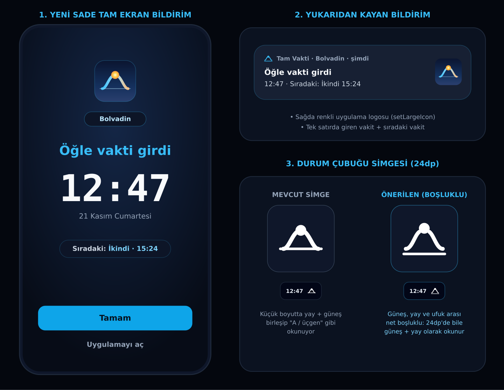

# Tam Ekran Bildirim, Kayan Bildirim Simgesi ve Logo İnceleme Raporu

> [!NOTE]
> Bu yalnızca inceleme ve görsel taslak raporudur. **Onayınız olmadan hiçbir kod veya görsel dosyasında değişiklik yapılmamıştır.**

---

## 1. Tam Ekran Bildirim (`PrayerAlertActivity`) — Eksikler ve Fazlalıklar

Mevcut [activity_prayer_alert.xml](file:///root/tam-vakti/android/app/src/main/res/layout/activity_prayer_alert.xml) ve [values/colors.xml](file:///root/tam-vakti/android/app/src/main/res/values/colors.xml) incelendiğinde 4 önemli bulgu öne çıkıyor:

1. **Gereksiz detay kartı (Fazlalık):**
   - Şu an altta büyük bir kart içinde **rekât bilgisi** (*"Öğle namazı: 4 rekât ilk sünnet, 4 rekât farz..."*) ve hemen üstteki dev saatin birebir tekrarı olan **`"Vakit girişi 12:42"`** yazısı var.
   - **Öneri:** Bu kart ve rekât metinleri tamamen kaldırılsın. Yerine yalnızca tek satırlık sakin bir hap kalsın: **`Sıradaki: İkindi · 15:24`**.
2. **Açık tema sızıntısı (Hata / Uyumsuzluk):**
   - Uygulama tamamen **Arctic koyu tema** olmasına rağmen `values/colors.xml` açık tema (`alert_bg: #F4F8FC`, bembeyaz zemin) tanımlıyor. Telefon açık sistem temasındaysa özellikle **İmsak/Sabah vaktinde göz alan bembeyaz bir tam ekran** açılıyor.
   - **Öneri:** Tam ekran bildirim her zaman **Arctic koyu tema** (`#090E1A`) ile açılsın.
3. **Orantısız büyük logo (Fazlalık):**
   - Mevcut `alertLogo` `150dp × 150dp` boyutunda, ekranın üçte birini kaplıyor.
   - **Öneri:** `76dp × 76dp` zarif boyuta çekilip altına sade konum rozeti (`Bolvadin`) ve nefes alan büyük tipografi (`Öğle vakti girdi` + `12:47`) oturtulsun.
4. **Test düğmesi metni:** `MainActivity.testFullScreenAlert()` içindeki örnek metin de yeni sade yapıya uygun temizlenir.

---

## 2. Yukarıdan Kayan Normal Bildirim ve Durum Çubuğu Simgesi

### 2.1. Durum çubuğu küçük simgesi (`ic_stat_tamvakti.xml`)
- **Sorun:** Mevcut [ic_stat_tamvakti.xml](file:///root/tam-vakti/android/app/src/main/res/drawable/ic_stat_tamvakti.xml) tek renk beyazda çizildiğinde yay çizgisi ile güneş dairesi birbirine yapışıyor ve 24dp boyutunda durum çubuğunda **küçük bir "A" harfi veya üçgen gibi** okunuyor (ekran görüntülerinizde saatin hemen yanında net görülüyor). Ayrıca `scaleX="1.12"` nedeniyle kenarlara çok yaklaşıyor.
- **Öneri:** Güneş dairesi ile sağ-sol yay kolları ve ufuk çizgisi arasında **net negatif boşluk (gap)** bırakılsın (taslakta sağ altta görüldüğü gibi). 24dp boyutta bile *"ufuk + yay + güneş"* olarak kristal netliğinde okunur. (Aynı temiz negatif boşluk Android 13+ temalı simge olan `ic_launcher_monochrome.xml` için de uygulanabilir.)

### 2.2. Yukarıdan kayan bildirim (`Notifs.postAlert`)
- **Eksik:** Şu an [Notifs.kt](file:///root/tam-vakti/android/app/src/main/java/com/tamvakti/app/Notifs.kt#L155-L180) içinde **`setLargeIcon()` yok**. Yukarıdan kayan bildirimde sağda uygulamanın renkli logosu çıkmıyor.
- **Öneri:**
  - Sağ tarafa `logo_full` renkli logosu (`setLargeIcon`) eklensin.
  - Üst alt başlıkta şehir adı (`setSubText(city)`), gövdede ise tek satırda saat + sıradaki vakit (`12:47 · Sıradaki: İkindi 15:24`) gösterilsin.

---

## 3. Uygulama Logosu (`logo_full.png` / `ic_launcher_foreground.xml` / `logo.svg`)

- **Genel değerlendirme:** Lacivert–gece mavisi arka plan, camgöbeği→altın geçişli yay ve ortadaki sıcak güneş **uygulamanın Arctic kimliğiyle çok uyumlu ve özgün**. Ana logoyu kökten değiştirmeye gerek yok.
- **Ufak iyileştirme (isteğe bağlı):** `logo_full.png`'de yayın iki yuvarlak ucu ufuk çizgisinin hafifçe altına sarkıyor gibi duruyor; isterseniz ileride ufuk çizgisini 2px aşağı alıp hafif inceltebiliriz. Ancak şu an acil olan kısım kesinlikle **durum çubuğu küçük simgesi (`ic_stat_tamvakti`)** ve **tam ekran bildirim**dir.

---

## 4. Onayınız Halinde Uygulanacak Değişiklik Listesi (Tek İzole Commit)

1. `activity_prayer_alert.xml` + `PrayerAlertActivity.kt` + `values/colors.xml`: Tam ekran bildirimi daima Arctic koyu, rekât/detay kartsız, 76dp logolu, sade ve ferah hale getirme.
2. `ic_stat_tamvakti.xml` (+ `ic_launcher_monochrome.xml`): Güneş–yay–ufuk arasında net boşluk bırakarak durum çubuğundaki "A harfi" görüntüsünü giderme.
3. `Notifs.kt`: Yukarıdan kayan bildirime `setLargeIcon(logo_full)` ve sade `"12:47 · Sıradaki: ..."` gövde satırı ekleme.
4. `tamvakti.md` güncellemesi + tek izole commit (beğenilmezse tek `git revert` ile geri alınabilir).
