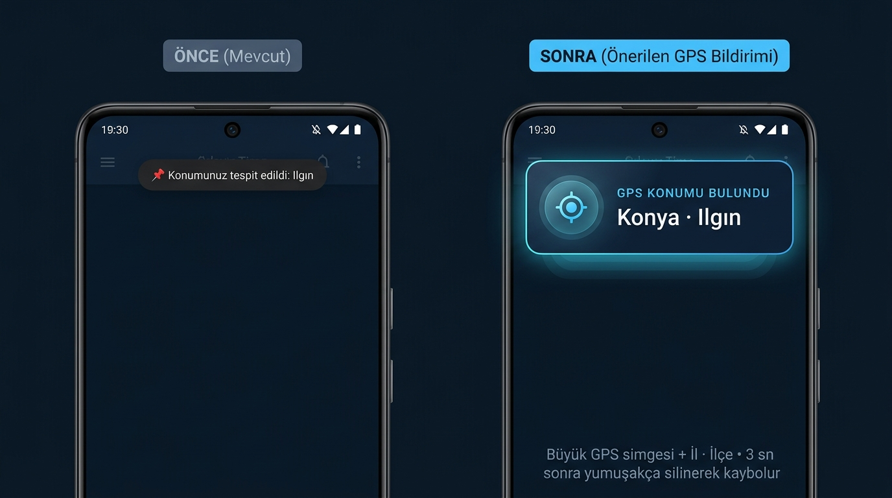

# Biriken İki Sorunun İnceleme ve Çözüm Raporu

---

## 1. Eski Bildirimlerin (Kerahat / Hatırlatma / Vakit) Otomatik Silinmemesi

### Neden oluyor?
23 Kasım ekran görüntüsünde Akşam vakti (17:43) girdikten 32 dk sonra bile 1 saat önceki **Kerahat vakti** bildiriminin bildirim çekmecesinde durmasının 2 teknik sebebi var:

1. **[AlarmReceiver.kt](file:///root/tam-vakti/android/app/src/main/java/com/tamvakti/app/AlarmReceiver.kt#L36-L39):** Vakit girdiğinde (`type == "vakit"`) yalnızca vakit öncesi hatırlatma (`ID_ALERT_REMINDER = 3002`) siliniyor; **`ID_ALERT_KERAHAT = 3003` silinmiyor.**
2. **[Notifs.kt](file:///root/tam-vakti/android/app/src/main/java/com/tamvakti/app/Notifs.kt#L185-L213):** `postAlert()` içinde Android'in yerel **`setTimeoutAfter(ms)`** özelliği kullanılmıyor. Bu özellik kullanılmadığında Android, kullanıcı eliyle kaydırıp silmediği sürece bildirimi sabaha kadar çekmecede tutuyor.

### Önerilen Çözüm (Sıfır ek pil maliyeti)
Android'in yerleşik `NotificationCompat.Builder.setTimeoutAfter(ms)` mekanizması ekstra alarm kurmadan, süre dolduğunda bildirimi işletim sistemi seviyesinde sessizce kaldırır (Android 8+ / API 26+).

| Bildirim Türü | ID | Önerilen Otomatik Temizleme |
|---|---|---|
| **Kerahat vakti** | `3003` | **45 dk sonra otomatik silinir** (`setTimeoutAfter(45 dk)`) + yeni vakit girdiğinde anında `cancelAlert(3003)`. (Tüm kerahat pencereleri 45 dk olduğu için kerahat bittiği anda bildirim de biter.) |
| **Vakitten önce hatırlatma** | `3002` | Vakit girdiğinde `cancelAlert(3002)` + **sıradaki vakte kalan süre kadar `setTimeoutAfter`** (vakit bildirimi kapalı olsa bile vakit girince kendiliğinden gider). |
| **Vakit girişi** *(ör. Akşam vakti girdi)* | `3001` | Yeni vakit girince zaten üzerine yazar. Buna ek olarak **60 dk sonra otomatik silinsin** (`setTimeoutAfter(60 dk)`) — böylece silinmeyen eski vakit bildirimi sabaha kadar kalmaz. |

> [!TIP]
> Vakit girişi (`3001`) için 60 dk yerine **45 dk** ya da **bir sonraki vakte kadar kalsın** derseniz tek bir sabit sayıyla ayarlayabiliriz.

---

## 2. GPS ile Konum Bulunduğunda Çıkan Bildirimin Yenilenmesi

### Mevcut durum
- [app.js](file:///root/tam-vakti/www/js/app.js#L1572-L1590) içinde hem otomatik GPS güncellemesinde (`checkAutoLocation`) hem elle GPS bulmada (`locateWithGPS` / kurulum sihirbazı) küçük `#appToast` kullanılıyor:
  - Kırmızı toplu iğne emojisi (`📍`) + küçük tek satır yazı (`Konumunuz tespit edildi: Ilgın`).

### Önerilen Yeni Tasarım
Standart küçük toast diğer kısa mesajlar için kalırken, **GPS ile konum bulunduğunda** ona özel şık bir **GPS Konum Kartı (`#gpsLocationBanner`)** gösterilecek:

- **Modern GPS Simgesi (SVG):** Kırmızı toplu iğne yerine Android/telefonların yerel konum simgesine benzeyen, camgöbeği (`#38bdf8`) halkalı ve hafif nabız efektli temiz **GPS hedef/uydu-ok SVG simgesi**.
- **Daha Büyük ve Net Tipografi (2 satır):**
  - Üst satır (küçük, camgöbeği): `GPS KONUMU BULUNDU` (otomatik değişimde `KONUM GÜNCELLENDİ`)
  - Alt satır (büyük, kalın beyaz): **`Konya · Ilgın`** (il + ilçe birlikte; merkezse sadece il adı)
- **Yumuşak Silinerek Kaybolma (Dissolve / Fade-Out):**
  - Ekrana hafifçe belirerek girer (~3,2 sn kalır), ardından aşağı/yukarı sertçe sıçramadan **yavaşça şeffaflaşıp (`opacity: 0`) hafif bulanıklaşarak (`blur(4px)`) ekrandan silinerek** kaybolur.
  - Dokunulursa anında kapanır; normal ekran etkileşimini engellemez.

### Görsel Taslak (Önce / Sonra)

