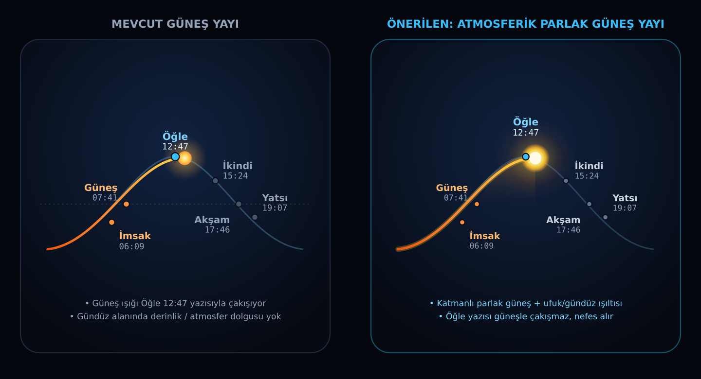

# Tam Vakti — Güneş Yolu Yayı Görsel Çalışması

> [!NOTE]
> Bu yalnızca görsel tasarım çalışmasıdır. **Onayınız olmadan güneş yayında hiçbir kod değişikliği yapılmamıştır.**

Paylaştığınız Sade mod ekran görüntüsü genel olarak çok dingin ve şık duruyor. Güneş yayını bozmadan **daha derin, daha parlak ve daha okunaklı** hale getirebilecek 4 küçük ama etkisi yüksek dokunuş öne çıkıyor:

---

## 1. Tespit Edilen 4 Görsel İyileştirme Fırsatı

1. **Katmanlı, yumuşak parlak güneş (dikenli ışınlar yerine atmosferik parıltı):**
   - Mevcut güneşte 8 kısa çizgi ışın + küçük tek halo var. Bunun yerine **3 katmanlı ışıltı** (geniş atmosferik hale + sıcak altın korona + berrak beyaz-sarı çekirdek) kullanılınca güneş hem gerçekten daha parlak görünür hem de Arctic koyu temanın modern estetiğine çok daha iyi oturur.
   - Gece saatlerinde hilal için de aynı şekilde hafif gümüşi-camgöbeği atmosfer parıltısı uygulanır.
2. **Gündüz alanında hafif sıcaklık dolgusu + ışıklı ufuk çizgisi:**
   - Geçen gündüz yayının altını ufuk çizgisine kadar çok hafif (`%22 → %0`) sıcak bir gün ışığı gradyanıyla doldurup ufuk çizgisine de güneşin altında hafifçe parlayan ince bir çizgi verince yay "boşlukta duran çizgi" yerine **gerçek bir gökyüzü kubbesi** hissi kazanır.
   - Geçen yay çizgisinin altına yumuşak bir dış parıltı (glow) katmanı eklenir.
3. **`Öğle 12:47` yazısının güneşle çakışmasının çözülmesi:**
   - Ekran görüntünüzde tam öğle saatlerinde güneş ve `12:47` yazısı üst üste biniyor. `Öğle` etiketini hafifçe yukarı (`dy: -25` → `-34`) alarak güneş tepe noktasındayken bile yazının tamamen temiz ve okunur kalmasını sağlayabiliriz.
4. **Sade modda dikey denge (isteğe bağlı ufak dokunuş):**
   - Ekran görüntünüzde üst başlık ile güneş yayı arasında biraz fazla boşluk, altta ise sayaç ile `Tüm vakitler & detay` düğmesi arasında biraz dar boşluk var; dikey dağılımı hafifçe dengeleyebiliriz.

---

## 2. Karar İçin Seçenekler

- **Seçenek 1:** Yukarıdaki **4 atmosferik güneş yayı dokunuşunu** uygulayalım (mevcut yapı ve tüm etiketler aynen kalır, sadece çok daha parlak ve kaliteli görünür).
- **Seçenek 2:** Güneş yayına şimdilik hiç dokunmayalım; bunun yerine başka bir alana (ör. **Kıble pusulası**, **Aylık İmsakiye**, **Ana ekran widget'ları** veya **Ayarlar**) odaklanalım.
