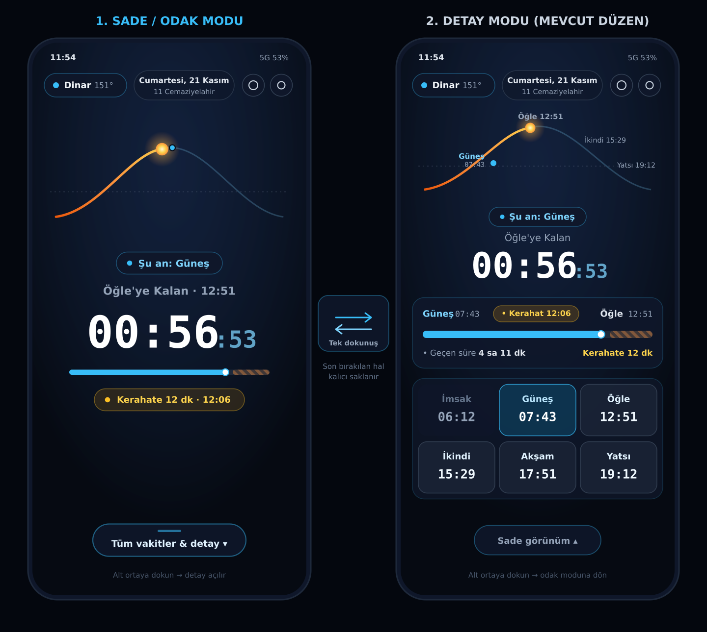
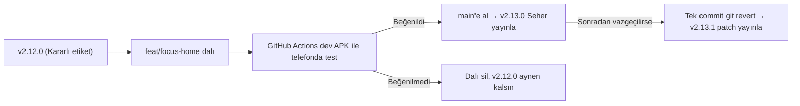

# Tam Vakti — Sade / Odak Modu ve Güvenli Geri Dönüş Tasarım Raporu

> [!NOTE]
> Bu rapor yalnızca inceleme ve tasarım taslağıdır. **Onayınız olmadan kod tabanında hiçbir değişiklik yapılmamıştır.**

---

## 1. Mevcut Ekranın Analizi

Paylaştığınız ekran görüntüsünde kalabalık hissinin iki temel nedeni öne çıkıyor:

1. **Aynı bilginin iki kez tekrarlanması:** 6 vaktin tamamı hem güneş yolu yayında (`İmsak 06:12` … `Yatsı 19:12`) hem de alttaki 3×2 kutularda birebir tekrar yazılıyor. İlerleme kartındaki saatler ve kerahat sayacıyla birlikte tek ekranda **14'ten fazla sayı/saat** aynı anda görünüyor.
2. **Kart içi sıkışma (gerçek cihaz bulgusu):** Ekran görüntüsünde ortadaki ilerleme kartının üst satırında `Güneş 07:43` + `• Kerahat 12:06` + `Öğle 12:51` yan yana gelince **`Öğle 12:51` sağ kenardan hafifçe taşıyor**.

Dolayısıyla *"önce tek bir vakte odaklan, isteyince alt orta kısımdan tek dokunuşla detaya geç"* fikri uygulamanın **"sadece namaz vaktine odaklanma"** ruhuyla birebir örtüşüyor.

---

## 2. Görsel Taslak: Sade / Odak Modu ↔ Detay Modu

### İki Mod Nasıl Çalışacak?

| Özellik | 1. Sade / Odak Modu | 2. Detay Modu (Mevcut Düzen) |
|---|---|---|
| **Güneş yolu yayı** | Yazısız, sakin yay + yalnızca güneş ve sıradaki vakit noktası | Tüm 6 vakit etiketi ve saatleriyle tam yay |
| **Merkez sayaç** | Daha büyük ve ferah geri sayım (`Öğle'ye Kalan · 12:51`) | Mevcut boyutta geri sayım |
| **İlerleme ve kerahat** | İnce tek çizgi + yalnızca kerahat varken tek satır amber hap | Tam kart (başlangıç/bitiş saatleri + geçen süre + kerahat, sağ taşma düzeltilmiş) |
| **6 vakit kutusu (3×2)** | Gizli | Açık (vakitlere dokununca uyarı ayarları açılır) |
| **Alt orta düğme** | `Tüm vakitler & detay ▾` | `Sade görünüm ▴` |

### Kalıcı Hafıza Davranışı
- Alt orta kısımdaki düğmeye tek dokunuşla iki görünüm arasında yumuşak geçiş yapılır.
- Son bırakılan durum `localStorage` içine (`tamvakti_home_mode`: `"focus"` veya `"detail"`) anında kaydedilir.
- Kullanıcı ekranı **sade** bıraktıysa uygulama ertesi gün de sade açılır; **detayda** bıraktıysa detayda kalır.
- İlk açılışta hangi modun varsayılan olacağına siz karar verirsiniz (öneri: mevcut kullanıcılar şaşırmasın diye isteğe bağlı olarak `focus` ya da `detail`).

---

## 3. Eski Sürüme / Eski Görünüme Rahatça Geri Dönüş Yapısı

*"Beğenmezsek eski haline rahatça döndürebilelim"* şartını iki katmanda güvence altına alabiliriz:

### Katman 1 — Kod İçi Tahribatsız (Non-Destructive) Mimari
Mevcut ana ekran HTML/CSS yapısı **silinmez ve parçalanmaz**.
- `<section id="viewPrayer" data-mode="focus">` tek bir nitelik (`data-mode`) üzerinden CSS ile iki durumu yönetir.
- `data-mode="detail"` seçili olduğunda bugünkü `v2.12.0` düzeninin birebir aynısı (üstelik `Öğle 12:51` taşması düzeltilmiş şekilde) görünür.
- Yeni görünüm beğenilmezse **uygulama içinden alt ortaya bir kez dokunup Detay modunda bırakmak** bile eski deneyimi anında geri getirir. İstenirse Ayarlar'a da *"Ana ekran görünümü: Sade / Detay"* satırı eklenebilir.

### Katman 2 — Git ve Android Sürüm (APK) Seviyesinde Geri Dönüş
Android güvenlik kuralı gereği, telefonda kurulu `versionCode`'dan daha düşük bir APK doğrudan üzerine kurulamaz (önce silmek gerekir). Bu yüzden geri dönüşü zahmetsiz tutmak için şu iş akışı en güvenlisidir:

1. **Veri uyumluluğu:** Yeni özellik mevcut `localStorage` anahtarlarına dokunmaz, yalnızca tek bir yeni anahtar (`tamvakti_home_mode`) ekler. Geri dönüşte hiçbir ayar, konum veya alarm kaybolmaz.
2. **İzole tek commit:** Odak modu değişikliği diğer hata düzeltmelerinden ayrı, temiz bir commit/dal içinde yapılır; böylece gerekirse tek `git revert` ile 10 saniyede çıkarılabilir.
3. **Üzerine kurarak geri dönüş:** `v2.13.0` yayınlandıktan sonra bile vazgeçerseniz, `git revert` yapıp `v2.13.1` (yüksek `versionCode`) çıkarıldığında uygulama içi güncelleyici üzerinden verileri silmeden tek tıkla eski görünüme dönülebilir.

---

## 4. Onayınız Öncesi Netleştirilecek 3 Kısa Karar

Uygulamaya geçmemi isterseniz şu 3 noktada tercihinizi belirtmeniz yeterli:

1. **Odak modunda güneş yolu yayı:** Görsel taslaktaki gibi *yazısız sade yay* mı kalsın, yoksa Odak modunda güneş yayı da tamamen gizlenip sadece sayaç mı kalsın?
2. **İlk varsayılan görünüm:** Güncelleme kurulduğunda ilk açılışta **Sade / Odak** mı açılsın, yoksa mevcut düzen (**Detay**) açık gelip kullanıcı alt ortadan mı sadeleştirsin?
3. **Kapsam:** Bu güncellemede yalnızca Odak/Detay geçişini mi yapalım, yoksa bir önceki rapordaki kritik düzeltmelerden (ör. `Öğle 12:51` taşması, geri tuşu, aynı dakikadaki alarm çakışması) seçtiklerinizi de ayrı commit olarak ekleyelim mi?
