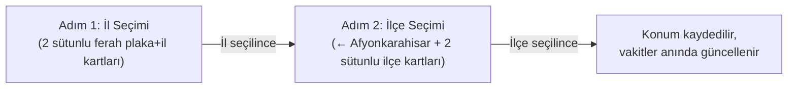

# Şehir ve İlçe Seçimi Ekranı Modernizasyon Raporu

> [!NOTE]
> Bu rapor yalnızca tasarım ve mimari önerisidir. **Onayınız olmadan şehir seçim ekranında (`#locationModal`) hiçbir kod değişikliği yapılmamıştır.**

---

## 1. Mevcut Ekran Neden Eski ve Kullanışsız Hissediliyor?

Mevcut [locationModal](file:///root/tam-vakti/www/index.html#L744-L780) ve [_renderCityList](file:///root/tam-vakti/www/js/app.js#L1058-L1132) incelendiğinde 4 temel sorun görünüyor:

1. **81 ilin tek tek düz liste halinde dökülmesi:** Kullanıcı örneğin *Afyonkarahisar → Bolvadin* seçmek için listeyi aşağı kaydırıp küçük `"18 ilçe"` düğmesine dokunuyor, sonra açılan sıkışık küçük etiketler arasından ilçeyi arıyor.
2. **Eski açık tema kalıntıları:** HTML'de hâlâ eski Adaçayı yeşili/açık tema sınıfları (`bg-white`, `text-[#0f3e2e]`, `bg-sky-50`) kalmış; Arctic koyu tasarımla doku bütünlüğü zayıf.
3. **Sık gidilen yerler hafızası yok:** Sık sık iki ilçe arasında (ör. Dinar ↔ Bolvadin) gidip gelen kullanıcı her seferinde baştan aramak zorunda kalıyor.
4. **Yurt dışı desteği görünür değil:** GPS yurt dışında zaten çalışıyor ama elle seçmek isteyen bir kullanıcıya hiçbir yol göstermiyor.

---

## 2. Önerilen Modern Arctic Tasarım: 2 Adımlı (İl → İlçe) + Hızlı Arama

Uygulamanın sade, hızlı ve çevrimdışı kimliğine yakışan yeni ekran **3 temiz katmandan** oluşur:

### Üst Sabit Alan (Her Zaman Erişilebilir)
1. **Canlı Akıllı Arama Çubuğu:** Yazmaya başladığınız anda adım beklemeden doğrudan eşleşen **il ve ilçeleri** gösterir (ör. `"bolv"` yazınca hemen `Bolvadin · Afyonkarahisar` kartı çıkar, tek dokunuşla seçilir). Türkçe karakter duyarsız (`i/ı`, `s/ş`, `g/ğ`).
2. **Tek Dokunuş GPS Kartı:** Arctic camgöbeği vurgulu modern kart: *"Konumumu otomatik bul"* (Türkiye + tüm dünyada çalışır).
3. **Son Seçilenler Şeridi (en fazla 3 hap):** Kullanıcının daha önce seçtiği son 3 yer yatay hap olarak görünür (ör. `Bolvadin`, `Dinar`, `Ankara`). Tek dokunuşla geçiş sağlanır.

### Ana Seçim Alanı — 2 Adımlı Temiz Akış

- **Adım 1 — İl Seçimi:**
  - 81 il, plaka numaralı (`03 Afyonkarahisar`, `06 Ankara`, `34 İstanbul`) **2 sütunlu ferah Arctic kartlar** halinde listelenir; her kartta ilçe sayısı soluk alt bilgi olarak yer alır (`18 ilçe`).
  - Karmaşık açılır-kapanır akordeon listesi tamamen kalkar!
- **Adım 2 — İlçe Seçimi:**
  - Bir ile dokununca ekran yumuşakça **Adım 2**'ye geçer:
    - Üstte **`← Afyonkarahisar`** geri çubuğu (tek dokunuşla illere döner).
    - En üstte öne çıkan **`İl Merkezi (Afyonkarahisar)`** kartı.
    - Altında tüm ilçeler **2 sütunlu büyük, dokunması rahat kartlar** halinde alfabetik sıralanır.
  - Geri tuşuna (Android fiziksel geri tuşu) basıldığında da Adım 2'deyken modalı kapatmak yerine Adım 1'e döner!

---

## 3. Diğer Ülkeler / Yurt Dışı Eklenmeli mi?

Burada uygulamanın **"hafif ve %100 çevrimdışı"** ilkesini korumak çok önemli:
- Dünya genelinde on binlerce şehri APK'ya gömmek gereksiz şişkinlik yaratır.
- **Önerilen dengeli çözüm (İki küçük sekme: `Türkiye` | `Yurt dışı`):**
  1. **`Türkiye` (varsayılan):** 81 il / 1002 ilçe + KKTC — %100 çevrimdışı, 2 adımlı İl → İlçe akışı.
  2. **`Yurt dışı` (isteğe bağlı, sadece ~2 KB):**
     - Türkiye dışındaki kullanıcıların en çok ihtiyaç duyduğu **~35 popüler şehir** (Mekke, Medine, Kudüs, Berlin, Münih, Frankfurt, Köln, Londra, Paris, Amsterdam, Brüksel, Viyana, Zürih, Bakü, Lefkoşa, Saraybosna, Üsküp, New York, Toronto, Sidney vb.) ülke adıyla birlikte çevrimdışı listelenir.
     - Listede olmayan herhangi bir dünya şehri için üstteki **GPS ile otomatik bul** düğmesi zaten küresel olarak çalışıyor (ve hesaplama yöntemi + saat dilimini otomatik ayarlıyor).

---

## 4. Onayınız Öncesi 2 Kısa Soru

1. **Yurt dışı sekmesi:** Yukarıdaki gibi hafif (~35 popüler şehir + KKTC) bir `Yurt dışı` sekmesi ekleyelim mi, yoksa şimdilik yalnızca `Türkiye` (2 adımlı İl → İlçe + GPS) mi olsun?
2. **Son seçilenler:** Üstte son seçilen 3 yerin hızlı hap olarak görünmesini ister misiniz?
